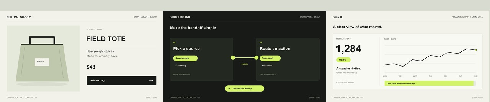

# Motion studies

Three original portfolio concepts for minimal product storytelling. The products and interfaces are fictional; each study was created for this portfolio. All visuals and sound are original.

| Study | Design and motion contribution | Length |
| --- | --- | --- |
| [Neutral Supply](01-neutral-supply.mp4) | Commerce art direction, tote/bottle vector illustration, shop-to-detail cuts, add-to-bag feedback, and timed sound accents. | 7 s |
| [Switchboard](02-switchboard.mp4) | Paired-action interface, selection states, animated connection, completion state, typography, and timed sound accents. | 7 s |
| [Signal](03-signal.mp4) | Illustrative dashboard, number and chart animation, transition to a graphic mark, typography, and timed sound accents. Metrics are fictional. | 7 s |

Each study includes design, code, motion, and procedural sound. [The showreel](showreel.mp4) joins all three in that order (21 s). [The sound sequence](sound-design.wav) is a standalone 21-second piece: short clicks, textured swishes, and restrained low-frequency accents.

Videos: 1280 × 720, 30 fps, H.264 MP4 with stereo AAC. Sound master: 48 kHz stereo, 16-bit PCM WAV. Rendered from code-drawn frames and encoded with macOS AVFoundation. Source code is retained privately and is not included here.

